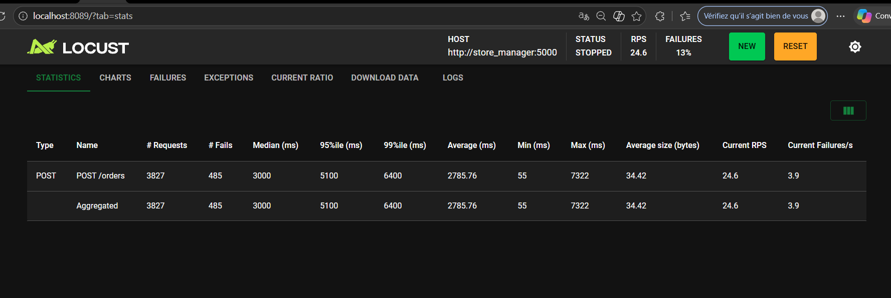
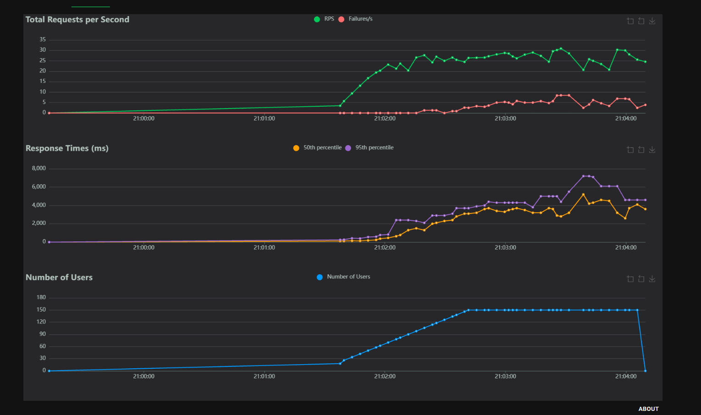

# Labo 08 – Activité 7 : test de charge avec Locust

## Mise en place

- `locustfiles/locustfile.py` : chaque utilisateur virtuel envoie `POST /orders` (utilisateur 1 à 3, produit 1 ou 2, quantité 1), avec une pause de 1 à 3 s entre deux requêtes. Une réponse est comptée comme réussie si elle a le statut `201` et contient un `order_id`.
- Un service `locust` est ajouté au `docker-compose.yml` (réseau `labo08-network`, port `8089`). Il cible directement `http://store_manager:5000`.
- Paramètres (comme au labo 4, activité 5) : **150 utilisateurs**, **spawn rate 2**. Les 150 utilisateurs sont atteints après environ 75 s ; le test a duré environ 2 min 30 s au total.
- Version testée : la branche `main` au moment du test. Les handlers de la saga y sont encore les versions de départ (`OrderCreated` → `StockDecreased` → `PaymentCreated` → `SagaCompleted`, sans retrait de stock ni appel au Payments API). Une commande test faite avant la charge a bien terminé sa saga (`Saga terminée avec succès ! Votre order_id = 1`).

## Résultats




| Mesure | Valeur |
|---|---|
| Nombre de requêtes `POST /orders` | 3827 |
| Échecs | 485 (13 %) |
| Temps de réponse médian | 3000 ms |
| 95e centile | 5100 ms |
| 99e centile | 6400 ms |
| Moyenne / min / max | 2786 ms / 55 ms / 7322 ms |
| Débit | environ 25 à 30 RPS (24,6 RPS à l'arrêt) |

État de la base après le test :

```
+-----------+
| commandes |
+-----------+
|      3432 |
+-----------+
+------------+----------+
| product_id | quantity |
+------------+----------+
|          1 |     1000 |
|          2 |      500 |
|          3 |        2 |
|          4 |       90 |
+------------+----------+
```

Erreurs dans les logs du `store_manager` (extrait) :

```
Handler - INFO - {'event': 'SagaCompleted', 'error': '(mysql.connector.errors.OperationalError) 1040 (08004): Too many connections ...'}
Handler - INFO - {'event': 'SagaCompleted', 'error': '(mysql.connector.errors.DatabaseError) 1040 (HY000): Too many connections ...'}
```

## Observations

1. **Ça tient bien jusqu'à environ 100 utilisateurs, puis ça se dégrade.** Au début du test, les réponses prennent quelques centaines de millisecondes et il n'y a aucun échec. Vers 21:02:20 (environ 100 utilisateurs), la médiane passe à plus de 2 s, puis se stabilise entre 3 et 5 s quand on atteint 150 utilisateurs (95e centile jusqu'à environ 7 s). Les premiers échecs apparaissent au même moment, et montent jusqu'à 5 à 8 par seconde.

2. **Le débit plafonne à environ 25 à 30 RPS.** Une fois les 150 utilisateurs atteints, le nombre de requêtes par seconde n'augmente plus, et c'est le temps de réponse qui grimpe. Chaque utilisateur attend sa réponse (environ 3 s) puis fait une pause de 1 à 3 s avant de recommencer. Avec 150 utilisateurs, on obtient environ 150 / (3 + 2) ≈ 30 requêtes par seconde. Le service est donc saturé : il ne traite pas les requêtes plus vite, il les fait attendre plus longtemps.

3. **La cause principale des échecs : trop de connexions MySQL (erreur 1040).** `get_sqlalchemy_session()` (dans `src/db.py`) appelle `create_engine(...)` à **chaque** appel. Un « engine » SQLAlchemy contient son propre pool de connexions. Ainsi, chaque commande crée un nouveau pool, qui garde sa connexion ouverte même après `session.close()`. Sous charge, ces connexions s'accumulent plus vite qu'elles ne sont libérées, et MySQL refuse les nouvelles une fois sa limite atteinte (151 connexions par défaut). Les requêtes concernées reçoivent une erreur 500, et l'événement `OrderCreationFailed` est publié (on voit la saga se terminer avec le champ `error` dans les logs).

4. **Le `201` ne veut pas dire que la saga est finie.** `POST /orders` enregistre la commande, publie `OrderCreated` puis répond. La suite de la saga se passe en arrière-plan, dans le consommateur Kafka. Locust mesure donc seulement la création de la commande, pas la saga complète. Ici, les handlers de `main` ne modifient pas encore le stock (il est resté à 1000 et 500 après plus de 3000 commandes) et n'appellent pas le Payments API. Avec l'`OutboxProcessor`, qui fait un appel HTTP synchrone vers Payments dans un seul thread consommateur, il faudrait s'attendre à un retard de traitement des événements sous la même charge.

5. **Des commandes enregistrées malgré une réponse en échec.** Il y a 3432 commandes en base, alors que Locust compte 3827 − 485 = 3342 succès, plus la commande test faite à la main. Il y a donc environ 89 commandes de plus que de réponses `201`. Dans `add_order`, après le `session.commit()`, la lecture de `new_order.id` recharge l'objet depuis MySQL ; si cette nouvelle connexion est refusée (erreur 1040), la requête renvoie une erreur 500 alors que la commande est déjà enregistrée. Le client croit que sa commande a échoué, mais elle existe en base.

## Conclusion

Le Store Manager supporte bien une charge moyenne. À 150 utilisateurs, il sature autour de 25 à 30 requêtes par seconde, avec une médiane de 3 s et 13 % d'échecs. Le goulot d'étranglement n'est pas Kafka mais la gestion des connexions MySQL : comme un nouvel `engine` est créé à chaque requête, on finit par dépasser la limite de connexions. Pour corriger, il faudrait créer **un seul** `engine` au niveau du module `db.py`, avec un pool de taille fixe (`pool_size`, `max_overflow`), et réutiliser ce pool dans toutes les sessions. Il faudrait aussi utiliser un serveur WSGI de production (par exemple Gunicorn) plutôt que le serveur de développement de Flask.
