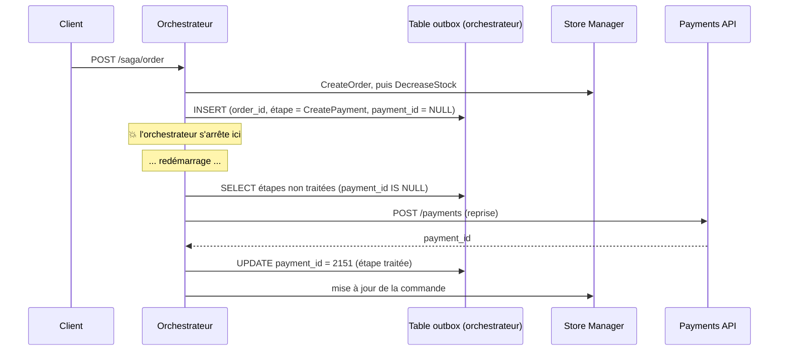

# Labo 08 – Réponse à la question 3

## Question 3

> Est-ce qu'une architecture Saga orchestrée pourrait aussi bénéficier de l'utilisation du patron Outbox, ou c'est un bénéfice exclusif de la saga chorégraphiée ? Justifiez votre réponse avec un diagramme ou en faisant des références aux classes, modules et méthodes dans le code.

**Oui, une saga orchestrée en bénéficie aussi.** Le patron Outbox ne règle pas un problème propre à la chorégraphie. Il règle le problème de la **double écriture** : un service modifie sa base de données, puis doit prévenir un autre système (appel HTTP ou message Kafka). Si l'application s'arrête entre les deux, la base est modifiée mais l'autre système n'est jamais prévenu. Ce problème existe dès qu'une saga enchaîne des étapes sur plusieurs services, avec ou sans orchestrateur.

### Le problème dans notre saga orchestrée (labo 6)

Dans le labo 6, l'état de la saga n'existe **qu'en mémoire**, dans l'attribut `current_saga_state` de `OrderSagaController` (`src/controllers/order_saga_controller.py`) :

```python
def __init__(self):
    super().__init__()
    # NOTE: veuillez lire le commentaire de ce classe pour mieux comprendre les limitations de ce implémentation
    self.current_saga_state = OrderSagaState.START
    ...

while self.current_saga_state is not OrderSagaState.END:
    ...
    elif self.current_saga_state == OrderSagaState.STOCK_DECREASED:
        self.create_payment_handler = CreatePaymentHandler(self.create_order_handler.order_id, order_data)
        self.current_saga_state = self.create_payment_handler.run()
```

Si l'orchestrateur s'arrête juste après `DecreaseStockHandler.run()` (commande créée et stock diminué dans le Store Manager), l'appel de `CreatePaymentHandler.run()` n'a jamais lieu, et rien ne permet de le reprendre. La commande reste sans paiement : c'est exactement la situation que l'Outbox règle au labo 8. Le document arc42 du labo 6 le dit lui-même (section 11, « Absence de persistance de l'état en cas de plantage ») : la mitigation proposée est de persister l'état pour pouvoir reprendre au redémarrage. C'est le principe de l'Outbox.

### Comment l'Outbox s'appliquerait à l'orchestrateur

Avant chaque appel à un service, l'orchestrateur enregistrerait dans sa propre table la prochaine action à faire (ou l'état courant de la saga), dans une transaction. Ensuite seulement, il exécuterait l'action, puis marquerait la ligne comme traitée. Au démarrage, un processeur (l'équivalent de `OutboxProcessor().run()` dans `store_manager.py` au labo 8) reprendrait les lignes non traitées :



Concrètement, dans le code du labo 6 :

- `CreatePaymentHandler.run()` ferait comme `StockDecreasedHandler.handle()` au labo 8 : écrire une ligne `Outbox` puis appeler un processeur, au lieu d'appeler `POST /payments-api/payments` directement ;
- `saga_orchestrator.py` appellerait le processeur au démarrage, comme `store_manager.py` au labo 8 :

```python
# labo 8, src/stocks/handlers/stock_decreased_handler.py : la même idée s'appliquerait à CreatePaymentHandler
new_outbox_item = Outbox(order_id=event_data['order_id'],
                        user_id=event_data['user_id'],
                        total_amount=event_data['total_amount'],
                        order_items=event_data['order_items'])
session.add(new_outbox_item)
session.flush()
session.commit()
OutboxProcessor().run(new_outbox_item)

# labo 8, src/store_manager.py : reprise au démarrage
OutboxProcessor().run()
```

### Où l'Outbox est encore plus important

L'Outbox sert aussi **du côté des services appelés**, quelle que soit la forme de la saga. Dans une saga orchestrée par messages (l'orchestrateur envoie des commandes dans Kafka et attend des réponses), chaque service doit à la fois modifier sa base et publier une réponse. Par exemple, le Store Manager enregistre la commande, puis publie `OrderCreated`. C'est la même double écriture que dans notre `add_order` du labo 8, qui fait `session.commit()` puis `OrderEventProducer().get_instance().send(...)`. Avec un Outbox transactionnel, la commande et le message à publier sont écrits dans la **même transaction**, puis un relais publie le message. Aucun des deux ne peut exister sans l'autre.

### Différence entre les deux approches

| | Saga orchestrée | Saga chorégraphiée |
|---|---|---|
| Où la saga peut « perdre » une étape | Dans l'orchestrateur (état en mémoire) et à chaque double écriture des services | À chaque handler qui modifie la base puis publie l'événement suivant |
| Où mettre l'Outbox | Dans l'orchestrateur (prochaine action / état de la saga) et dans chaque service qui publie une réponse | Dans chaque service, à chaque étape (ici `StockDecreasedHandler`) |
| Reprise | L'orchestrateur relit sa table au démarrage et continue la machine à états | Chaque service relit sa table au démarrage (`OutboxProcessor().run()`) |

**Conclusion** : l'Outbox n'est pas exclusif à la chorégraphie. En chorégraphie, il est indispensable, car aucun composant central ne connaît l'état global de la saga. En orchestration, l'orchestrateur est un point central, ce qui rend la persistance de son état encore plus importante : s'il tombe, toutes les sagas en cours sont perdues, comme l'indique l'arc42 du labo 6. L'Outbox (ou plus généralement la persistance de l'état de la saga avant chaque action) est la manière de corriger ce point.
