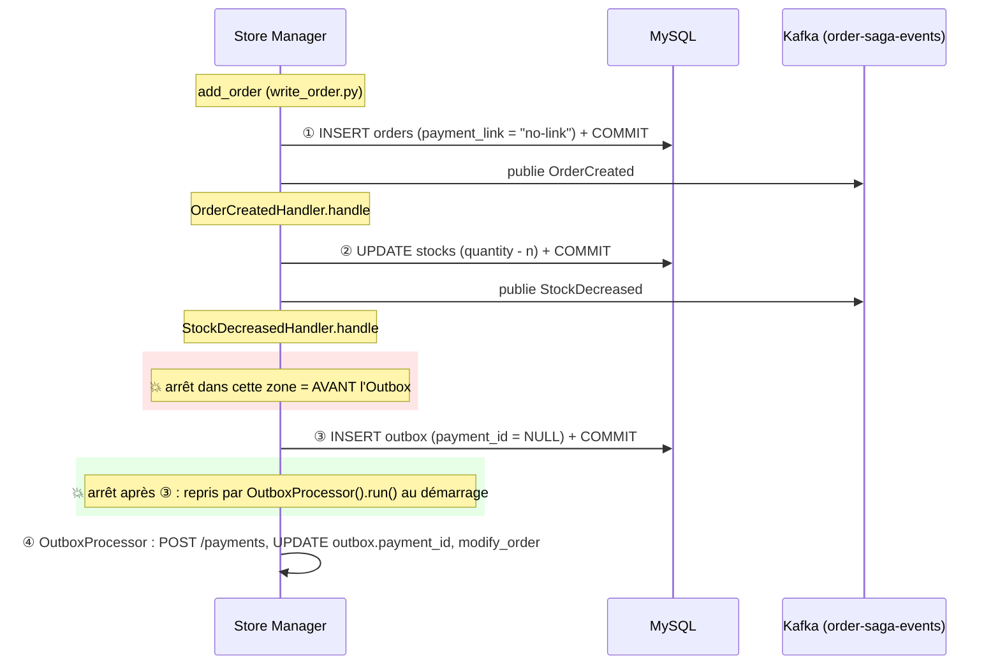

# Labo 08 – Réponse à la question 4

## Question 4

> Qu'est-ce qui arriverait si notre application s'arrête avant la création de l'enregistrement dans la table `Outbox` ? Comment on pourrait améliorer notre implémentation pour résoudre ce problème ? Justifiez votre réponse avec un diagramme ou en faisant des références aux classes, modules et méthodes dans le code.

### Ce que l'Outbox protège, et ce qu'il ne protège pas

Voici les étapes de la saga jusqu'à l'Outbox, chacune dans une transaction séparée :



- **Arrêt après ③** : c'est le cas prévu par le patron. La ligne `outbox` existe avec `payment_id = NULL`, et `OutboxProcessor().run()` (appelé au démarrage dans `store_manager.py`) la reprend. Notre test le montre (voir plus bas).
- **Arrêt avant ③** : la commande existe (①) et le stock est diminué (②), mais **aucune ligne `outbox`** n'existe. Au redémarrage, `OutboxProcessor.run()` ne regarde **que** la table `outbox` :

  ```python
  outbox_items = session.query(Outbox).filter(Outbox.payment_id.is_(None)).all()
  ```

  Il ne voit donc pas cette commande. Elle reste avec `payment_link = "no-link"` et le stock reste diminué, sans paiement ni compensation. C'est le risque décrit dans la section 11 de l'arc42 (« Cohérence des commandes en cas d'échec à un point spécifique de la saga »).

Dans ce deuxième cas, le résultat dépend de Kafka. Le consommateur valide ses offsets automatiquement, en arrière-plan (`src/orders/queries/order_event_consumer.py`) :

```python
self.consumer = KafkaConsumer(
    self.topic,
    ...
    enable_auto_commit=True,   # l'offset est validé périodiquement (toutes les 5 s par défaut), pas après le traitement
    ...
)
```

- Si l'offset de `StockDecreased` **n'était pas encore validé**, Kafka relivre l'événement au redémarrage, et `StockDecreasedHandler` crée la ligne `outbox`. La saga se termine « par chance ».
- Si l'offset **était déjà validé**, ou si l'arrêt a lieu dans `OrderCreatedHandler` entre le `commit` du stock (②) et l'envoi de `StockDecreased`, l'événement est **perdu**. La commande reste incohérente pour toujours.

C'est le problème de la **double écriture** : chaque étape fait un `session.commit()` dans MySQL **puis** un `send()` dans Kafka. Ces deux opérations ne sont pas atomiques, comme on le voit dans `add_order` et dans `OrderCreatedHandler.handle` :

```python
# OrderCreatedHandler.handle
check_out_items_from_stock(session, event_data['order_items'])
session.commit()                                   # ② écrit dans MySQL
event_data['event'] = "StockDecreased"
...
order_event_producer.get_instance().send(config.KAFKA_TOPIC, value=event_data)   # puis publie dans Kafka
```

### Ce que nous avons observé

Nous avons provoqué un vrai arrêt brutal : `docker pause payments_api` (la demande de paiement reste bloquée), `POST /orders`, puis `docker kill store_manager` 2 secondes plus tard.

**Juste après l'arrêt** : la ligne `outbox` a été écrite (③), mais pas traitée.

```txt
mysql> SELECT id, order_id, payment_id FROM outbox;
1   1   2149
2   2   NULL          <- commande 2 : demande enregistrée, paiement jamais créé
mysql> SELECT id, is_paid, payment_link FROM orders;
1   1      http://api-gateway:8080/payments-api/payments/process/2149
2   NULL   no-link
```

**Après le redémarrage** (`docker unpause payments_api`, `docker start store_manager`) : l'Outbox reprend la demande.

```txt
OutboxProcessor - INFO - 1 outbox items processed.

mysql> SELECT id, is_paid, payment_link FROM orders WHERE id = 2;
2   1   http://api-gateway:8080/payments-api/payments/process/2153
```

**Mais** le test montre aussi les effets de la relivraison par Kafka. Les offsets de `OrderCreated` et de `StockDecreased` n'étaient pas encore validés au moment de l'arrêt, donc les deux événements ont été **traités une deuxième fois** :

```txt
OrderConsumer - DEBUG - Evenement : OrderCreated      <- relu
OrderConsumer - DEBUG - Evenement : StockDecreased    <- relu
OrderConsumer - DEBUG - Evenement : PaymentCreated
OrderConsumer - DEBUG - Evenement : StockDecreased    <- relu
OrderConsumer - DEBUG - Evenement : PaymentCreated

mysql> SELECT id, order_id, payment_id FROM outbox;
1   1   2149
2   2   2151
3   2   2152          <- doublon
4   2   2153          <- doublon
mysql> SELECT product_id, quantity FROM stocks WHERE product_id = 1;
1   998               <- 1000 - 2, pour une commande d'une seule unité
```

Dans la base du service de paiement, la commande 2 a même **quatre paiements** :

```txt
mysql> SELECT id, order_id FROM payments WHERE id >= 2149;   -- labo05_payments_db
2149   1
2150   2    <- la demande bloquée pendant l'arrêt : traitée par Payments API après la reprise,
            <- mais le Store Manager était mort et n'a jamais reçu la réponse (paiement orphelin)
2151   2    <- reprise par OutboxProcessor au démarrage (ligne outbox 2)
2152   2    <- StockDecreased relu (ligne outbox 3)
2153   2    <- StockDecreased relu (ligne outbox 4)
```

La commande 2 a donc reçu **quatre paiements** et son stock a été diminué **deux fois**. L'Outbox garantit qu'une demande enregistrée sera traitée **au moins une fois**, mais nos handlers ne sont pas **idempotents** : traiter deux fois le même événement produit deux fois l'effet. Le paiement 2150 montre aussi qu'une demande envoyée peut réussir sans que l'appelant le sache : la reprise doit pouvoir demander « ce paiement existe-t-il déjà ? » plutôt que de le recréer.

> En testant, nous avons aussi corrigé un bug dans `OutboxProcessor._process_outbox_item`. La ligne à marquer était cherchée par `order_id` (`filter(Outbox.order_id == outbox_item.order_id).first()`), donc toujours la première ligne de la commande. Les lignes 3 et 4 restaient à `payment_id = NULL`, et chaque redémarrage aurait créé de nouveaux paiements. Elle est maintenant cherchée par son `id` (`filter(Outbox.id == outbox_item.id)`).

### Comment améliorer l'implémentation

**1. Écrire l'Outbox dans la même transaction que la commande (mitigation de l'arc42).** Dans `add_order` (`src/orders/commands/write_order.py`), on ajouterait la ligne `Outbox` **avant** le `session.commit()` qui crée la commande :

```python
new_order = Order(user_id=user_id, total_amount=total_amount, payment_link="no-link")
session.add(new_order)
session.flush()
...
session.add(Outbox(order_id=new_order.id, user_id=user_id,
                   total_amount=total_amount, order_items=items))
session.commit()          # commande + demande de paiement : tout ou rien
```

Ainsi, dès qu'une commande existe, sa demande de paiement existe aussi. Il n'y a plus de fenêtre « avant l'Outbox » : au redémarrage, `OutboxProcessor.run()` retrouve toutes les commandes sans `payment_id`. Le processeur doit alors vérifier que le stock a bien été diminué avant de créer le paiement (par exemple avec une colonne d'état dans `outbox` : `PENDING_STOCK` → `PENDING_PAYMENT` → `DONE`), ou déclencher la compensation.

**2. Outbox transactionnel pour tous les événements (plus général).** Au lieu d'appeler `send()` après chaque `commit()`, chaque handler écrirait l'événement suivant (`StockDecreased`, `PaymentCreated`, …) dans une table `outbox_events`, **dans la même transaction** que sa modification. Un relais (un thread qui lit la table, ou un outil de CDC comme Debezium) publie ensuite ces lignes dans Kafka et les marque comme envoyées. La double écriture disparaît : un changement en base sans son événement devient impossible.

**3. Rendre les handlers idempotents.** Puisque Kafka peut relivrer un message (nous l'avons observé), chaque étape doit pouvoir être rejouée sans effet de bord :
- une contrainte `UNIQUE` sur `outbox.order_id`, et un test dans `StockDecreasedHandler.handle` (si une ligne existe déjà pour cette commande, ne rien recréer) ;
- dans `OrderCreatedHandler`, enregistrer que le stock de cette commande a déjà été diminué (par exemple un statut sur la commande) avant de refaire `check_out_items_from_stock` ;
- côté Payments API, refuser un deuxième paiement pour le même `order_id` (clé d'idempotence), et retourner le paiement existant. Cela règle aussi le paiement orphelin 2150 : la reprise aurait reçu ce paiement au lieu d'en créer un nouveau.

**4. Valider l'offset Kafka après le traitement.** Avec `enable_auto_commit=False` et un `consumer.commit()` après chaque `handler.handle(...)` réussi, un événement n'est jamais marqué « lu » avant d'avoir été traité. Combiné à l'idempotence (point 3), on obtient un traitement « exactement une fois » en pratique : un message peut être relu, mais son effet n'est appliqué qu'une seule fois.

**5. Une tâche de réconciliation, en dernier filet de sécurité.** Au démarrage (à côté de `OutboxProcessor().run()`) ou périodiquement, chercher les commandes restées à `payment_link = "no-link"` depuis plus de quelques minutes, puis reprendre leur saga ou la compenser (remettre le stock et annuler la commande).
